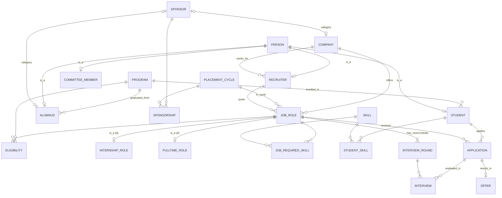

# PlaceIQ — Campus Placement & Recruitment Management System
### FDS Course Project · Phase 2: Design, Normalization & DDL

**DBMS:** PostgreSQL 18 (needs 15 or later) · **Team:** 4 members · **DDL:** [02_ddl.sql](02_ddl.sql)

---

## 1. Problem statement

Today the placement committee runs recruitment from shared spreadsheets: one row per student, per company, per interview round. This causes:

- **Duplication.** A company's details are repeated on every applicant's row.
- **Inconsistency.** A CGPA is updated in one sheet but not another.
- **Silent rule violations.** An ineligible student applies, or a placed student keeps sitting for interviews.

PlaceIQ replaces the sheet with a normalized relational database that **enforces the placement policy inside the database itself**.

## 2. Business rules (these drive every constraint)

| # | Rule | Enforced by |
|---|---|---|
| BR-1 | Every student belongs to exactly one program | `student.program_id NOT NULL` + FK |
| BR-2 | Roll number and email are unique | `UNIQUE` (alternate keys) |
| BR-3 | CGPA is between 0 and 10 | `CHECK` |
| BR-4 | Every job is **either** an internship **or** a full-time role, never both, never neither | Discriminator + composite FK gives **disjoint**; a deferred constraint trigger gives **total** (Phase 3) |
| BR-5 | The recruiter who posts a job must work for that company | Composite FK `(posted_by, company_id)` → `recruiter(person_id, company_id)` |
| BR-6 | A student applies to a job at most once | `UNIQUE(student_id, job_id)` |
| BR-7 | A student can be interviewed only in a round of the job they applied to | Two composite FKs on `interview` sharing `job_id` |
| BR-8 | A student cannot have two overlapping interview slots | `EXCLUDE USING gist` |
| BR-9 | An offer is made only against an application, and at most one per application | FK + `UNIQUE` |
| BR-10 | `responded_at` is set **iff** the offer was accepted or declined | `CHECK` |
| BR-11 | A student may apply only if: program is eligible, CGPA ≥ cut-off, backlogs ≤ limit, before the deadline, and not opted out | **Trigger** (Phase 3). Spans 4 tables |
| BR-12 | **One-offer policy:** at most one accepted offer per student per cycle. Accepting one auto-withdraws all other open applications in that cycle | **Trigger + transaction** (Phase 3) |
| BR-13 | A sponsor is either a company or an alumnus (union type) | Discriminator + composite FK |
| BR-14 | "Placed" status is derived from offers, never typed in | **View** (Phase 3) |
| BR-15 | A student who holds an offer cannot be deleted | `ON DELETE RESTRICT` blocks the cascade |

---

## 3. Enhanced ER model

### 3.1 Entities and attributes
Notation: **bold** = key, *italic* = derived, {braces} = multi-valued, (composite).

| Entity | Type | Attributes |
|---|---|---|
| PERSON | Strong, superclass | **person_id**, name (first_name, last_name), email *(candidate key)*, phone, created_at |
| STUDENT | Subclass of PERSON | roll_no *(candidate key)*, batch_year, cgpa, active_backlogs, opted_out, {skills}, *placement_status*, *offer_count* |
| RECRUITER | Subclass of PERSON | designation |
| COMMITTEE_MEMBER | Subclass of PERSON | cc_role, term_start, term_end |
| ALUMNUS | Subclass of PERSON | graduation_year, current_employer |
| PROGRAM | Strong | **program_id**, program_code *(CK)*, program_name, duration_months |
| COMPANY | Strong | **company_id**, company_name *(CK)*, sector, hq_city, website |
| SPONSOR | **Category (union type)** of COMPANY ∪ ALUMNUS | **sponsor_id**, sponsor_type |
| PLACEMENT_CYCLE | Strong | **cycle_id**, cycle_name *(CK)*, cycle_type, academic_year, start_date, end_date |
| JOB_ROLE | Strong, superclass | **job_id**, title, role_type, location, openings, application_deadline |
| INTERNSHIP_ROLE | Subclass of JOB_ROLE | stipend_monthly, duration_weeks, ppo_possible |
| FULLTIME_ROLE | Subclass of JOB_ROLE | ctc_lpa, fixed_lpa, joining_bonus |
| INTERVIEW_ROUND | **Weak**, owner JOB_ROLE | **round_no** *(partial key)*, round_type, is_elimination |
| SKILL | Strong | **skill_id**, skill_name |

### 3.2 Relationships: cardinality and participation
"Total" means every entity on that side must participate (a double line in Chen notation).

| Relationship | Between | Cardinality | Participation | Attributes |
|---|---|---|---|---|
| ENROLLED_IN | STUDENT – PROGRAM | N : 1 | Student total, Program partial | — |
| GRADUATED_FROM | ALUMNUS – PROGRAM | N : 1 | Alumnus total | — |
| WORKS_FOR | RECRUITER – COMPANY | N : 1 | Recruiter total | — |
| OFFERS | COMPANY – JOB_ROLE | 1 : N | Job total | — |
| IN_CYCLE | JOB_ROLE – PLACEMENT_CYCLE | N : 1 | Job total | — |
| POSTS | RECRUITER – JOB_ROLE | 1 : N | Both partial | — |
| ELIGIBLE_FOR | JOB_ROLE – PROGRAM | M : N | Both partial | min_cgpa, max_backlogs |
| HAS_SKILL | STUDENT – SKILL | M : N | Both partial | proficiency |
| REQUIRES | JOB_ROLE – SKILL | M : N | Both partial | min_proficiency |
| **APPLIES_TO** | STUDENT – JOB_ROLE | M : N | Both partial | applied_at, status, status_updated_at |
| HAS_ROUND | JOB_ROLE – INTERVIEW_ROUND | 1 : N, **identifying** | Round total | — |
| **EVALUATED_IN** | **[APPLIES_TO]** – INTERVIEW_ROUND | M : N, **aggregation** | Both partial | slot_start, slot_end, venue, result, score |
| **RESULTS_IN** | **[APPLIES_TO]** – OFFER | 1 : 0..1, **aggregation** | Offer total | offered_at, response_deadline, status, responded_at |
| SPONSORS | SPONSOR – PLACEMENT_CYCLE | M : N | Both partial | purpose, amount_inr |

### 3.3 EER constructs used (this covers all of Module 4)

| Construct | Where | Constraint | Why |
|---|---|---|---|
| **Specialization / generalization** | PERSON → STUDENT, RECRUITER, COMMITTEE_MEMBER, ALUMNUS | **Overlapping, partial** | A student can also be a committee member; a guest speaker could be a plain PERSON |
| **Specialization** | JOB_ROLE → INTERNSHIP_ROLE, FULLTIME_ROLE | **Disjoint, total** | Stipend and CTC are different attributes that no job has both of |
| **Weak entity** | INTERVIEW_ROUND, owned by JOB_ROLE | Identifying relationship HAS_ROUND | "Round 2" means nothing without its job |
| **Aggregation** | APPLIES_TO treated as an entity that participates in EVALUATED_IN and RESULTS_IN | — | You interview an *application* (a student-for-a-job pair), not a student in general |
| **Category / union type** | SPONSOR = COMPANY ∪ ALUMNUS | Partial (not every company sponsors) | Superclasses of *different* types share one role |
| **Multi-valued attribute** | STUDENT.{skills} | → STUDENT_SKILL relation | 1NF |
| **Derived attribute** | STUDENT.placement_status, offer_count | → computed in a view | Storing it would invite inconsistency |
| **Composite attribute** | PERSON.name | → first_name, last_name | — |

### 3.4 Diagram (relational / crow's-foot view)
It renders in VS Code (Markdown Preview Mermaid extension) and on GitHub. For the **Chen-notation EER slide**, redraw sections 3.1–3.3 in draw.io. Chen notation can show the specialization circles (d / o), the double borders and the aggregation box, which crow's-foot cannot.



---

## 4. ER → relational mapping (Elmasri–Navathe steps)

| Step | Rule | Applied to |
|---|---|---|
| 1 | Strong entity → table | program, person, company, placement_cycle, job_role, skill |
| 2 | Weak entity → table, PK = owner PK + partial key | interview_round **(job_id, round_no)** |
| 3 | 1:1 → FK on the total side + `UNIQUE` | offer → application |
| 4 | 1:N → FK on the N side | student.program_id, recruiter.company_id, job_role.company_id / cycle_id / posted_by |
| 5 | M:N → bridge table, PK = both FKs | eligibility, student_skill, job_required_skill, application*, interview, sponsorship |
| 6 | Multi-valued attribute → own table | student_skill |
| 8 | Specialization → one table per subclass, sharing the superclass PK (option 8A) | student, recruiter, committee_member, alumnus; internship_role, fulltime_role |
| 9 | Category → surrogate key in a new table, FK in each member | sponsor + company.sponsor_id / alumnus.sponsor_id |

\* `application` gets a surrogate `application_id` as its PK for convenience. The natural key `(student_id, job_id)` stays as a `UNIQUE` alternate key, and that is what `interview` and `offer` reference.

**Why 8A rather than one wide table?** A single `job_role` table holding both `stipend` and `ctc` would need NULLs in half the rows. It also couldn't say "ctc is mandatory for full-time" with a simple `NOT NULL`. With 8A, every subtype column is `NOT NULL`.

### Final relational schema
<u>PK</u> · *FK* · AK = alternate (candidate) key

```
program          (program_id, program_code AK, program_name, duration_months)
placement_cycle  (cycle_id, cycle_name AK, cycle_type, academic_year, start_date, end_date)
                  AK (cycle_type, academic_year)
skill            (skill_id, skill_name AK)
person           (person_id, first_name, last_name, email AK, phone AK, created_at)
student          (*person_id*, roll_no AK, *program_id*, batch_year, cgpa, active_backlogs, opted_out)
committee_member (*person_id*, cc_role, term_start, term_end)
sponsor          (sponsor_id, sponsor_type)
company          (company_id, company_name AK, sector, hq_city, website, *sponsor_id* AK, sponsor_type)
alumnus          (*person_id*, *program_id*, graduation_year, current_employer, *sponsor_id* AK, sponsor_type)
sponsorship      (sponsorship_id, *sponsor_id*, *cycle_id*, purpose, amount_inr)  AK (sponsor_id, cycle_id, purpose)
recruiter        (*person_id*, *company_id*, designation)
job_role         (job_id, *company_id*, *cycle_id*, *posted_by*, title, role_type, location, openings,
                  application_deadline)  AK (company_id, cycle_id, title)
internship_role  (*job_id*, role_type, stipend_monthly, duration_weeks, ppo_possible)
fulltime_role    (*job_id*, role_type, ctc_lpa, fixed_lpa, joining_bonus)
eligibility      (*job_id*, *program_id*, min_cgpa, max_backlogs)
student_skill    (*student_id*, *skill_id*, proficiency)
job_required_skill (*job_id*, *skill_id*, min_proficiency)
application      (application_id, *student_id*, *job_id*, applied_at, status, status_updated_at)
                  AK (student_id, job_id)
interview_round  (*job_id*, round_no, round_type, is_elimination)
interview        (*student_id*, *job_id*, round_no, slot_start, slot_end, venue, result, score)
offer            (offer_id, *student_id*, *job_id*, offered_at, response_deadline, status, responded_at)
                  AK (student_id, job_id)
placement_log    (log_id, *student_id*, *job_id*, action, details, logged_at)
```
That is 22 tables in total. In `interview`, `(student_id, job_id, round_no)` is the composite PK.

---

## 5. Normalization: from the placement spreadsheet to BCNF

### 5.0 Starting point (UNF): the committee's spreadsheet
| roll_no | name | email | prog_code | prog_name | cgpa | skills | company | sector | hq_city | cycle | job_title | role_type | pay | min_cgpa | round_no | round_type | slot | result | app_status |
|---|---|---|---|---|---|---|---|---|---|---|---|---|---|---|---|---|---|---|---|
| DBA12-007 | Riya S | riya@… | PGDBA | PG Diploma in Business Analytics | 8.4 | Python, SQL, R | McKinsey | CONSULTING | Mumbai | Final 26-27 | Business Analyst | FULLTIME | 32 LPA | 8.0 | 1 | CASE | 18-Nov 10:00 | CLEARED | SHORTLISTED |
| DBA12-007 | Riya S | riya@… | PGDBA | PG Diploma in Business Analytics | 8.4 | Python, SQL, R | McKinsey | CONSULTING | Mumbai | Final 26-27 | Business Analyst | FULLTIME | 32 LPA | 8.0 | 2 | HR | 18-Nov 14:00 | SCHEDULED | SHORTLISTED |
| DBA12-019 | Arjun K | arjun@… | PGDBA | PG Diploma in Business Analytics | 7.6 | SQL | McKinsey | CONSULTING | Mumbai | Final 26-27 | Business Analyst | FULLTIME | 32 LPA | 8.0 | — | — | — | — | REJECTED |

**Anomalies, demonstrated live from this sheet:**
- **Update anomaly.** McKinsey changes its HQ city. That means editing every row of every applicant and every round. Miss one and the data contradicts itself.
- **Insertion anomaly.** A new company posts a job before anyone has applied. There is no student or round to put in the row, and `roll_no` is part of the key, so the job cannot be recorded at all.
- **Deletion anomaly.** Arjun is the only applicant to some job and his row is deleted. The job's pay, cut-off and rounds disappear with him.

### 5.1 Functional dependencies
Let **J** = (company, cycle, job_title), the natural identifier of a job.

| FD | Dependency |
|---|---|
| FD1 | roll_no → name, email, prog_code, cgpa |
| FD2 | email → roll_no *(so email is also a candidate key of a student)* |
| FD3 | prog_code → prog_name |
| FD4 | company → sector, hq_city |
| FD5 | J → role_type, pay |
| FD6 | J, prog_code → min_cgpa |
| FD7 | J, round_no → round_type |
| FD8 | roll_no, J → app_status |
| FD9 | roll_no, J, round_no → slot, result |
| MVD | roll_no →→ skills *(multi-valued: independent of everything else)* |

### 5.2 1NF: atomic values
`skills` = "Python, SQL, R" is not atomic. Splitting each skill into its own row gives a relation whose key would have to include `skill`. That causes rows to multiply (every round × every skill), which is the MVD at work. The fix is to separate it out at once:

- **StudentSkill**(<u>roll_no, skill</u>)
- **Sheet1NF**(<u>roll_no, J, round_no</u>, name, email, prog_code, prog_name, cgpa, sector, hq_city, role_type, pay, min_cgpa, round_type, slot, result, app_status)

Every attribute is now atomic, and the key is **{roll_no, company, cycle, job_title, round_no}**.

### 5.3 2NF: remove partial dependencies
A non-key attribute must depend on the *whole* key, not on part of it.

| Partial dependency (on part of the key) | Decompose into |
|---|---|
| roll_no → name, email, prog_code, prog_name, cgpa | **Student**(<u>roll_no</u>, name, email, prog_code, prog_name, cgpa) |
| company → sector, hq_city *(company ⊂ key)* | **Company**(<u>company</u>, sector, hq_city) |
| J → role_type, pay | **Job**(<u>company, cycle, job_title</u>, role_type, pay) |
| J, round_no → round_type | **Round**(<u>J, round_no</u>, round_type) |
| roll_no, J → app_status, min_cgpa *(min_cgpa via roll_no→prog_code)* | **Application**(<u>roll_no, J</u>, app_status, min_cgpa) |
| *(full dependency remains)* | **Interview**(<u>roll_no, J, round_no</u>, slot, result) |

### 5.4 3NF: remove transitive dependencies
No non-key attribute may depend on another non-key attribute.

| Relation | Transitive chain | Fix |
|---|---|---|
| Student | roll_no → prog_code → prog_name | **Program**(<u>prog_code</u>, prog_name); Student keeps prog_code as FK |
| Application | (roll_no, J) → roll_no → prog_code, and (J, prog_code) → min_cgpa | **Eligibility**(<u>J, prog_code</u>, min_cgpa); drop min_cgpa from Application |

### 5.5 BCNF: every determinant must be a candidate key
| Relation | Non-trivial FDs | Is every determinant a superkey? |
|---|---|---|
| Program | prog_code → prog_name | ✅ |
| Student | roll_no → all; **email → roll_no** | ✅ Both roll_no and email are candidate keys, so BCNF holds even with two keys |
| Company | company → sector, hq_city | ✅ |
| Job | J → role_type, pay | ✅ |
| Eligibility | (J, prog_code) → min_cgpa | ✅ |
| Round | (J, round_no) → round_type | ✅ |
| Application | (roll_no, J) → app_status | ✅ |
| Interview | (roll_no, J, round_no) → slot, result | ✅ |
| StudentSkill | none non-trivial | ✅ (also 4NF, since the MVD is isolated) |
| placement_cycle | cycle_id, cycle_name, (cycle_type, academic_year): each determines all | ✅ Three candidate keys, all superkeys |

**All relations are in BCNF.** Every decomposition was a split on an FD X → Y into (X ∪ Y) and (R − Y), with X a key of the first part. By Heath's theorem that makes it **lossless**. Every FD1–FD9 is still checkable inside one table, so the decomposition is also **dependency-preserving**.

After normalizing, we **add surrogate keys** for practicality: `job_id` replaces the 3-column J, and `person_id` replaces roll_no. The natural keys stay as `UNIQUE` constraints, so the FDs are still enforced. Then we apply the EER subtyping: `pay` splits into `stipend_monthly` and `ctc_lpa`, and Person is generalized.

### 5.6 The 3NF-but-not-BCNF trap we considered (for Q&A)
Suppose we had added *"each recruiter interviews for exactly one job"*:
**Panel**(student, job, recruiter) with FDs (student, job) → recruiter and **recruiter → job**.

- The key is (student, job). `recruiter → job` has a non-superkey determinant, so it is **not BCNF**. But `job` is a prime attribute, so it **is 3NF**.
- The BCNF decomposition is (recruiter, job) + (student, recruiter). It is lossless but **not dependency-preserving**: (student, job) → recruiter can no longer be checked within one table.
- **Our decision:** the business doesn't actually need that rule (a recruiter can interview for several roles), so we did not model it. Our schema stays in BCNF with nothing given up.

### 5.7 Deliberate non-redundancy decisions
| We do **not** store… | Because… |
|---|---|
| CTC/stipend in `offer` | It would create `offer → job_id → ctc_lpa`, a transitive dependency. The job tables hold it |
| `placement_status` in `student` | It is derived from `offer`; the view computes it (BR-14) |
| `cycle_id` in `application` | `job_id → cycle_id` would be transitive. The one-offer-per-cycle rule is a trigger instead |
| `company_name` in `job_role` | It is reached via `company_id` |

The **constant discriminator columns** (`internship_role.role_type = 'INTERNSHIP'`, `company.sponsor_type = 'COMPANY'`) are *not* a normal-form violation. Their domain has a single value, so they introduce no non-trivial FD. They exist only so a composite FK can enforce disjointness declaratively.

---

## 6. DDL design highlights (from [02_ddl.sql](02_ddl.sql))

| Technique | Where | FDS concept |
|---|---|---|
| `CHECK` domain constraints | cgpa, dates, enums, email/phone patterns | Domain integrity |
| `UNIQUE` alternate keys | roll_no, email, program_code, (company, cycle, title) | Candidate keys |
| Composite FK onto (id, discriminator) | subtype tables, sponsor members | **Disjoint** specialization, enforced declaratively |
| Two composite FKs sharing a column | `interview` → application and interview_round, both via `job_id` | Referential integrity across an **aggregation** |
| Composite FK (posted_by, company_id) | `job_role` → recruiter | Cross-entity consistency (BR-5) |
| `EXCLUDE USING gist (… WITH =, tstzrange(…) WITH &&)` | `interview` | A constraint that `UNIQUE` cannot express |
| `ON DELETE CASCADE` | person → subtypes, job → rounds | The subtype or weak entity can't exist without its owner |
| `ON DELETE RESTRICT` | program → student, job → application, application → offer | Protect historical records |
| `ON DELETE SET NULL (col)` | recruiter → job_role.posted_by, sponsor → company | Keep the row, forget the link (PG15+ column list) |
| FK indexes | Section 6 of the DDL | PostgreSQL doesn't index FKs automatically |

**The RESTRICT-blocks-CASCADE chain (good Q&A material).** `DELETE FROM person WHERE …` cascades to `student`, which cascades to `application`. If that application has an `offer`, the RESTRICT on offer aborts the **entire** statement. A student holding an offer cannot be erased (BR-15).

---

## 7. Presentation split, re-cut for 4 members (15:00)

| Time | Member | Owns | Live / slides |
|---|---|---|---|
| 0:00–3:45 | **M1: Problem & EER** | The spreadsheet pain and anomalies (shown on the real sheet). Why a DBMS beats file processing. Business rules. ER, then EER: specialization (o / d), the weak entity, aggregation, and the union type | Spreadsheet → Chen EER diagram |
| 3:45–7:30 | **M2: Schema & normalization** | ER → relational mapping steps. Super / candidate / alternate / foreign keys. FDs, then 1NF → 2NF → 3NF → BCNF. Lossless + dependency-preserving. The 3NF-not-BCNF trap | FD list + decomposition tree |
| 7:30–11:15 | **M3: DDL & queries** | Constraint techniques (section 6), shown live by inserting bad rows and watching them fail. Advanced queries: relational division, window ranking, HAVING with a subquery, views, each with its relational algebra | pgAdmin, live |
| 11:15–15:00 | **M4: Rules, transactions, performance** | One-offer trigger demo. Eligibility trigger rejecting an application. Atomic accept-offer transaction (ACID). Index EXPLAIN ANALYZE before/after. Parameterized queries against SQL injection. **Team learnings + close** | pgAdmin, live + recap |

**Q&A ownership:** each member answers questions about their own section, which shows individual understanding.

---

## 8. Project files and run order

| File | What it holds | Presenter |
|---|---|---|
| [run_all.ps1](run_all.ps1) | Rebuilds everything: `.\run_all.ps1` (default password `postgres`) | — |
| [02_ddl.sql](02_ddl.sql) | 22 tables, all declarative constraints, FK indexes | M2, M3 |
| [03_logic.sql](03_logic.sql) | 2 views, 4 trigger groups, 3 stored routines | M4 |
| [04_data.sql](04_data.sql) | Mock data: 16 companies, 180 students, about 1,200 applications, about 1,050 interviews, 96 offers. Loaded *through* the triggers in one transaction, with a fixed seed | M3 |
| [05_queries.sql](05_queries.sql) | The 5 advanced queries, each with business question, concepts and relational algebra | M3 |
| [06_demo.sql](06_demo.sql) | Live demo: 7 constraint violations, the eligibility trigger, the one-offer cascade, index EXPLAIN ANALYZE, SQL injection. Ends in `ROLLBACK`, so it can be rehearsed endlessly | M3, M4 |

**Triggers and procedures (03_logic.sql)**
| Object | Business rule |
|---|---|
| `trg_application_eligibility` | BR-11: opted out, deadline, program, CGPA, backlogs, already placed |
| `trg_offer_requires_open_app`, `trg_offer_marks_app_offered` | An offer needs a live application; the application then moves to OFFERED |
| `trg_offer_accept_guard` + `trg_offer_accept_cascade_*` | BR-12 one-offer policy: block a second acceptance; decline the other offers, withdraw open applications, free interview slots, write the audit log |
| `trg_job_total_*` (deferred constraint triggers) | BR-4 totality of the job specialization |
| `v_placement_status` | BR-14 derived placement status |
| `fn_apply_for_job`, `sp_accept_offer`, `sp_expire_stale_offers` | Parameterized entry points. The procedure locks the student row first, so concurrent acceptances queue up instead of deadlocking
