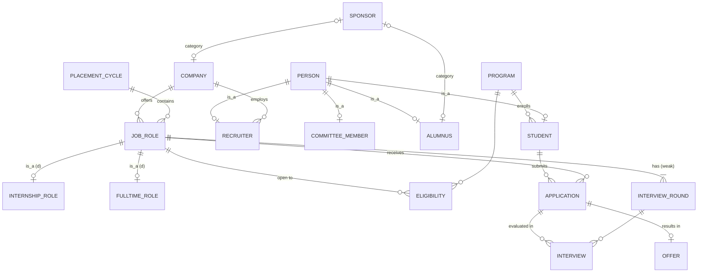

# PlaceIQ: Campus Placement & Recruitment Management System

A PostgreSQL database that replaces a placement committee's spreadsheets and **enforces the placement policy inside the database**: eligibility cut-offs, interview scheduling and the one-offer rule.

Built as the course project for **Fundamentals of Database Systems** (PGDBA, IIM Calcutta). It covers the full course arc: ER/EER modelling, relational mapping, normalization to BCNF, constraints, triggers, transactions, analytical SQL and indexing.


---

## The problem

The committee runs recruitment from spreadsheets with one row per student, per company, per interview round. That causes:

- **Duplication.** Company details are repeated on every applicant's row.
- **Anomalies.** You can't add a job until someone applies, and deleting the last applicant deletes the job.
- **Silent rule-breaking.** Ineligible students apply, students get double-booked for interviews, and placed students keep interviewing.

PlaceIQ normalizes this data into 22 BCNF tables. Each business rule becomes a constraint or a trigger, so the database itself rejects invalid data.

## Highlights

| Area | What's in it |
|---|---|
| **EER modelling** | Overlapping specialization (Person → Student / Recruiter / Committee / Alumnus); disjoint, total specialization (Job → Internship / Full-time); a weak entity (Interview Round); aggregation (an Application is evaluated in rounds); a **category / union type** (Sponsor = Company ∪ Alumnus) |
| **Normalization** | Worked from the raw spreadsheet: FDs, anomalies, 1NF → 2NF → 3NF → BCNF, lossless and dependency-preserving, plus a 3NF-vs-BCNF trade-off discussion |
| **Declarative integrity** | Disjointness enforced with composite FKs on (id, discriminator); `EXCLUDE USING gist` to stop overlapping interview slots; `ON DELETE CASCADE / RESTRICT / SET NULL (col)` chosen per relationship |
| **Triggers** | Eligibility on apply (CGPA, program, backlogs, deadline, opt-out); a **one-offer policy** that atomically declines other offers, withdraws open applications and frees interview slots; deferred constraint triggers for total specialization |
| **Transactions** | Atomic offer acceptance; row-level locking (`FOR UPDATE`) with a fixed lock order, so concurrent acceptances queue instead of deadlocking |
| **Analytical SQL** | Relational division, window functions (`DENSE_RANK`, `NTILE`, running `SUM OVER`), correlated subqueries, `LATERAL`, CTEs, views |
| **Performance** | `EXPLAIN ANALYZE` on 600k rows: **72.8 ms → 0.16 ms** with a composite index, **0.08 ms** with a partial index that is 25× smaller |
| **Security** | A live SQL-injection demo: string concatenation leaks all 180 records, while bound parameters return 0 |

## Schema at a glance



The full EER description, mapping steps, normalization proof and the business-rule-to-constraint catalogue are in **[01_design.md](01_design.md)**.

## The five showcase queries

| # | Business question | Techniques |
|---|---|---|
| Q1 | Which recruiters make offers to fewer applicants than the campus average? | Multi-table join, outer join, `FILTER`, `GROUP BY` / `HAVING` with a scalar subquery |
| Q2 | Who holds **every** skill a newly posted job requires? | **Relational division** (double `NOT EXISTS`) plus an anti-join |
| Q3 | Top-3 salaries per program, gap to the program average, pay quartile | Window functions over a view |
| Q4 | Day-by-day cumulative share of each batch placed | CTEs, calendar from `generate_series`, outer join, running total |
| Q5 | Students with strong grades who are unplaced because of interviews, and the round they failed | Correlated subqueries, `LATERAL`, composite-key joins |

## Run it

Requires PostgreSQL 15 or later (developed on 18).

```powershell
# Windows: from this folder. Creates the 'placeiq' database if missing.
.\run_all.ps1 -Password <your-postgres-password>

psql -U postgres -h localhost -d placeiq -f 05_queries.sql   # the 5 queries
psql -U postgres -h localhost -d placeiq -f 06_demo.sql      # live demo (rolls back)
```

On macOS / Linux:

```bash
createdb placeiq
for f in 02_ddl.sql 03_logic.sql 04_data.sql; do psql -d placeiq -v ON_ERROR_STOP=1 -f "$f"; done
```

The mock data uses a fixed seed, so every run produces the same dataset: 16 fictional companies, 180 students, about 1,200 applications, about 1,050 interviews and 96 offers. It is loaded **through** the triggers in a single transaction, so every row has passed every rule.

## Repository layout

| File | Purpose |
|---|---|
| [01_design.md](01_design.md) | Business rules, EER model, ER → relational mapping, normalization to BCNF, constraint catalogue |
| [02_ddl.sql](02_ddl.sql) | Schema: 22 tables, constraints, foreign-key indexes |
| [03_logic.sql](03_logic.sql) | Views, triggers, stored functions and procedures |
| [04_data.sql](04_data.sql) | Seeded mock data and recruitment simulation |
| [05_queries.sql](05_queries.sql) | The five showcase queries, annotated with relational algebra |
| [06_demo.sql](06_demo.sql) | Scripted live demo: constraint violations, trigger cascade, indexing, SQL injection (ends in `ROLLBACK`) |
| [run_all.ps1](run_all.ps1) | One-command rebuild |

---

*All company and person names in the dataset are fictional.*
